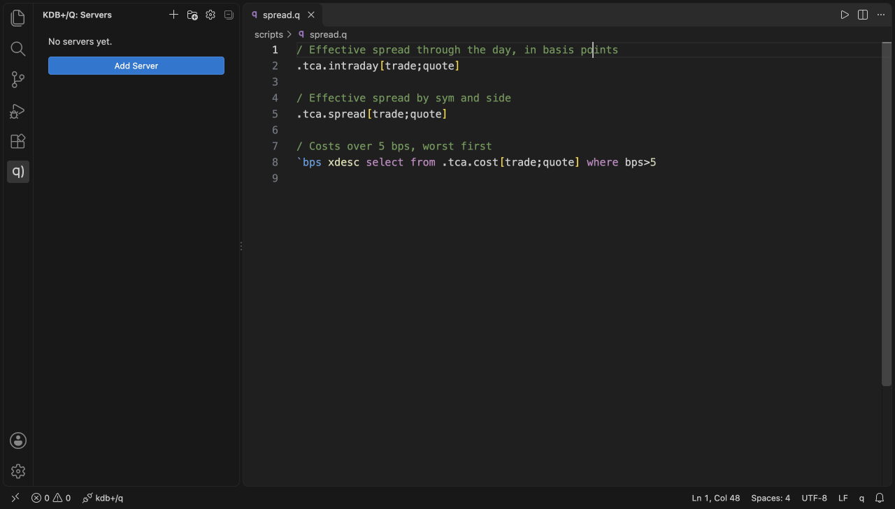
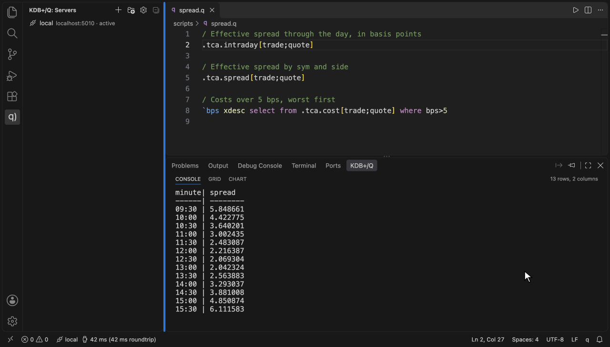
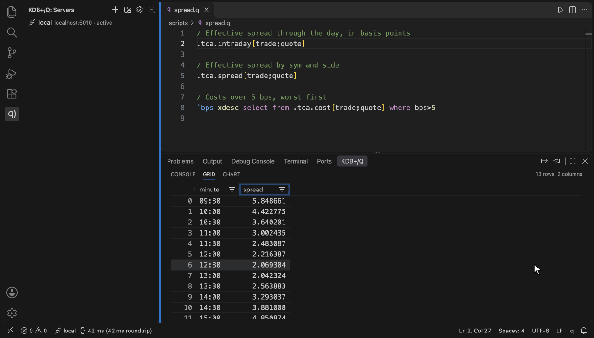
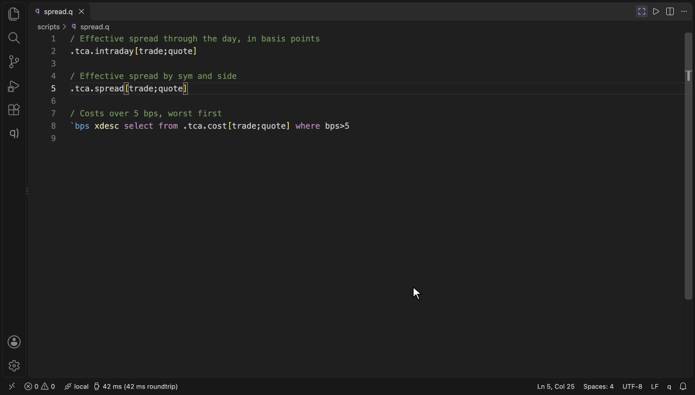
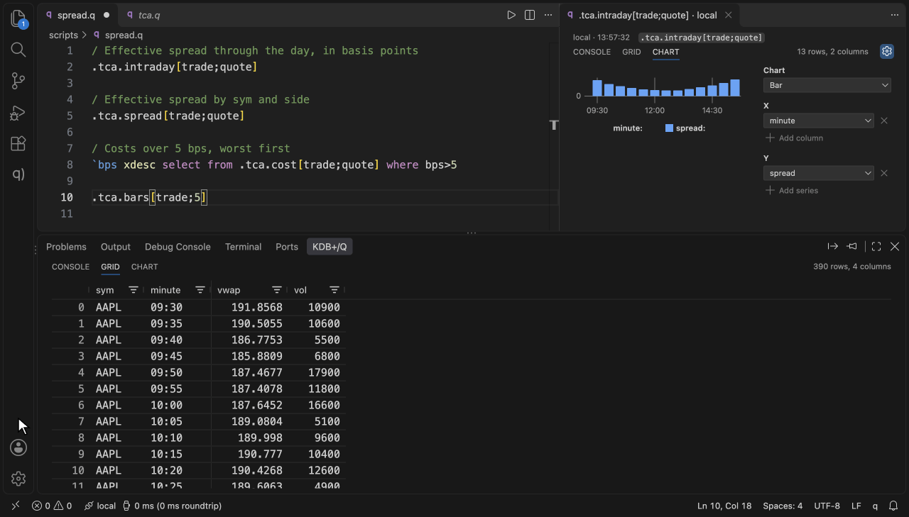
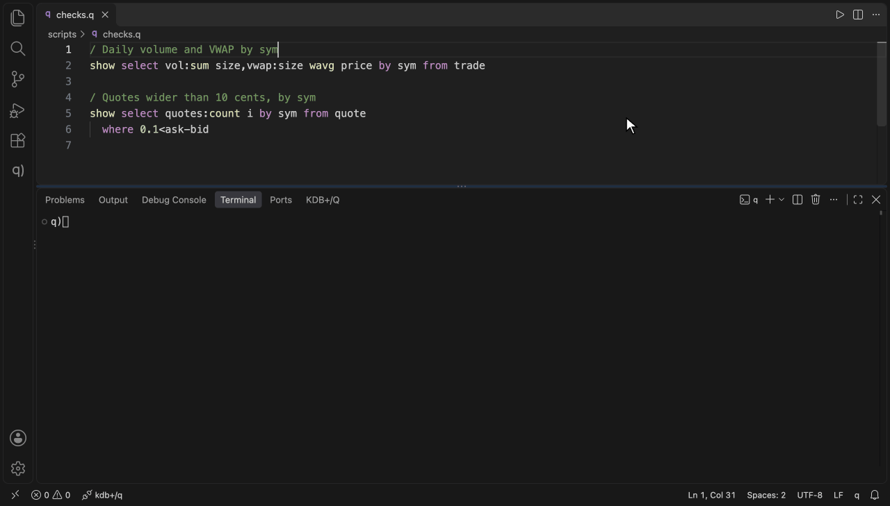

# Ink: kdb+/q toolkit

Ink is a VS Code extension for q. It runs your q code on the kdb+ processes you already have and shows the result as q's console display, a grid or a chart. It also reads the q code in your workspace to give hovers, Go to Definition, completion and syntax errors as you type.

**Requirements:** VS Code 1.140 or later, and a kdb+ process to connect to, or a q session you start in VS Code's terminal. Ink doesn't start or bundle q.

**Install:** search for "Ink: kdb+/q toolkit" in the Extensions view, or run `code --install-extension dflynch3.kdb-q-ext-vscode`.

## Walkthrough

The clips follow one piece of work in a small q codebase for transaction-cost analysis:

- `src/tca.q` defines `.tca.bars`, `.tca.cost`, `.tca.spread` and `.tca.intraday`, and `src/patch.q` holds a later fix to `.tca.intraday`.
- `src/init.q` loads test `trade` and `quote` tables and `src/tca.q`. A local q started with `q src/init.q -p 5010` is the server.
- `scripts/spread.q` holds the queries, and `scripts/checks.q` some checks to run as a script.

### 1. Add a server

The first time you press Cmd+Enter (Ctrl+Enter) on a line, Ink says no servers are defined and offers **Add Server**. Test connects with what you've typed, and Save writes the server to your settings and adds it to the Servers view, under the `q)` icon in the Activity Bar, which holds your servers in folders. In the clip, the server is `local`, on `localhost:5010`.

- Passwords never go in settings: a server's password is kept in VS Code's secure storage, asked for at each connect, or supplied by your firm's sign-on extension.

### 2. Run a query

**kdb+/q: Run Selected Text on Server**, Cmd+Enter (Ctrl+Enter), runs the selection, or the current line. ▶ in the editor's title bar runs the whole file. The result shows in the **KDB+/Q** panel, and the status bar gives the time the query took on the server, as `\t` gives it, and the roundtrip. The first run asks which server to use, and later runs go to that server, the active one. In the clip, `.tca.intraday[trade;quote]` runs on `local`, then the Console shows the same table as q prints it.

![Cmd+Enter on .tca.intraday[trade;quote] asks for a server, connects to local, and shows a table in the KDB+/Q panel with the timing in the status bar; the Console tab then shows the same table as q prints it](media/run-query.gif)

- The text is sent as written, as one query, as a q client sends it. A server reads line breaks as spaces, so statements on separate lines need `;` between them. To run lines as a script, see [Run in a terminal](#9-run-in-a-terminal).
- To switch servers, connect to another from the status bar menu or the Servers view, or click **Make Active** on an open server's row.

### 3. Read the result

The Grid shows tables, keyed tables, dictionaries and lists, with cells as q prints them. Click a header to sort in q's order. Click it again to reverse the sort, and a third time to clear it. Filter a number or time column with the funnel in its header: it compares as q does, with nulls smallest. Empty the filter's box to clear it. In the clip, `spread` is sorted both ways, then filtered to the rows over 4.

- Double-click a cell to drill into a nested value, and press Cmd+C (Ctrl+C) to copy cells. See [Running queries and reading results](docs/results.md).

### 4. Chart and pin

The Chart draws the whole result as a line, bars, a histogram or a scatter. It opens on a line for a time series, and its settings, shown and hidden by the gear at the right, change the type and the columns. **kdb+/q: Pin Result**, the pin in the panel's title bar, keeps the result in an editor tab of its own, which the next run doesn't replace. Drag the tab beside your script to keep it in view. In the clip, the spread is charted, switched to bars and pinned.

- A pinned result keeps its view, sort, filters and chart, and shows its server, time and query. Pinned results close with VS Code.

### 5. Find your way around

A hover on your own function shows its signature and the comment lines above its definition. A hover on a q keyword or a `.Q` or `.z` name shows KX's reference, which works offline. Go to Definition (F12) follows q's namespaces across every `.q` file in the workspace, and for a name defined more than once, lists every definition in a peek. In the clip, `.tca.spread` and `xbar` are hovered, and F12 follows `.tca.spread` to its definition, and `.tca.intraday` to its two, in `src/tca.q` and `src/patch.q`. The pinned result stays open, hidden to make room.

- Find All References, the outline and Go to Symbol in Workspace (Cmd+T, Ctrl+T) follow namespaces too. See [Navigation and editing](docs/navigation.md).

### 6. Write a call

After `.tca.`, completion offers the namespace's functions with their signatures and comments. Inside the brackets, the parameter hint highlights the current parameter and moves on with each `;`. In the clip, `.tca.bars[trade;5]` is written this way, then run with Cmd+Enter.

![Typing .tca. offers bars, cost, intraday and spread with their signatures; picking bars and typing an opening bracket shows the parameter hint, which moves from t to w after the ;. Cmd+Enter runs .tca.bars[trade;5], and the Grid shows VWAP and volume by sym in 5-minute bars](media/write-call.gif)

- Completion also offers a lambda's parameters and locals, your globals and q's keywords.

### 7. Change and compare

Select a changed definition and press Cmd+Enter to redefine the function on the server. The Console shows nothing, as q shows nothing for an assignment. Run the query again: the new result replaces the last in the panel, and the pinned result keeps the old one, for comparison. A new result's chart is worked out afresh, so it opens on a line again. In the clip, `.tca.intraday` changes from 30-minute to 15-minute bars.

### 8. Catch mistakes

The editor marks a bracket or string left open, and a closing bracket with no opener, as you type. A failed query shows q's error in the Console, with a backtrace from the line that failed back to your query. In the clip, a `]` is deleted, then `.tca.spread` runs with its arguments swapped, to make it fail.

![Deleting a closing bracket from a query underlines the end of the line, saying a closing bracket is expected; then .tca.spread[quote;trade], its arguments swapped, runs and the Console shows 'ask with a backtrace through .tca.cost and .tca.spread](media/errors.gif)

- Backtraces, and the time on the server in the status bar, come from protected evaluation, which is on by default. Turn it off for a gateway that allows only listed calls. See [Protected evaluation](#protected-evaluation).

### 9. Run in a terminal

**kdb+/q: Run Selected Text in Terminal**, Shift+Enter, sends the selection, or the current line, to the q session running in the active terminal. Ink writes the text to a temp file and sends `\l` with its path, so q loads it as a script: comments are skipped, an indented line continues the one before, and the run stops at the first error. In the clip, the q in VS Code's terminal was started with `q src/init.q`, apart from the server on 5010, and runs all of `scripts/checks.q`.

- As in any script, a result prints on one line, in the form `-3!` writes, cut at the console's width. `show` prints it as the console does.
- q must be able to read this machine's temp folder, so a q session on another machine, such as over ssh, can't load the file.

## Reference

### Servers and connections

- Add servers with **kdb+/q: Add Server**, or in settings.json under `kdb-q-ext-vscode.servers`. In settings, an object with `host` or `port` is a server and any other object is a folder. A server's fields are `host`, `port`, `user`, `timeout`, `protect`, `tls` and `auth`.
- The form saves to User settings, for all your workspaces, or Workspace settings, for anyone who opens this workspace. A server defined in both uses the Workspace definition; the two aren't merged.
- Folders nest to any depth. Drag servers and folders to move them. Moving or renaming a server closes its connection.
- A server with a problem in the settings, such as no host or an unknown field, shows a warning in the Servers view and isn't offered anywhere else until it's fixed.
- A new server has protected evaluation on, TLS off and a connection timeout of 2000 ms. `timeout` covers connecting and logging in, not queries. Without it, Ink waits as long as it takes, as `hopen` does.
- One connection is active, and runs go to it. Connecting to another server makes it active and leaves the first open. **Make Active** on a row switches back.
- A connection that fails or drops stays active and is shown closed, with its reason, and the status bar turns to the warning colour. The next run asks for a server rather than going to another one. **kdb+/q: Dismiss Closed Connection** forgets it.
- Each connection runs one query at a time. **kdb+/q: Disconnect from Server** closes a connection. A query running on it fails as `query cancelled`, though the server finishes it.
- Connect errors use q's words, such as `hop. OS reports: Connection refused`, `access` and `timeout`.
- The status bar shows the active server, and its tooltip lists the server's settings, without secrets. Click it for a menu of the server and password commands.

### Passwords and sign-on

- `auth` says where a password comes from:
  - none, or `"none"`: no password is sent
  - `"store"`: VS Code's secure storage
  - `"prompt"`: asked for at each connect and never kept
  - `"extension"`: your firm's sign-on extension
- A stored password is keyed by `user@host:port`, not by the server's name, so it's only sent to the host it was given for. Store one from the form or with **kdb+/q: Set Server Password**.
- Ink never deletes a stored password itself, not even when a server is removed, as another workspace may use it. **kdb+/q: Clear Server Password** lists stored passwords by login and deletes the one you pick.
- For `"extension"`, set `kdb-q-ext-vscode.authExtension` to the extension's ID, `publisher.name`. That extension exports `credentials(request)`, where `request` has the server's `path` (its folders, then its name), `host`, `port` and `user`. It returns `{ user?, password }`. It's called at every connect, so a token is always fresh.

### TLS

- `"tls": true` ("Use TLS" in the form) connects with TLS, as `tcps://` does in q.
- The server's certificate must chain to a CA that the system or Node trusts, or to one in `kdb-q-ext-vscode.tlsCaFile`. The host name isn't checked against the certificate, as q's client doesn't check it by default.
- `tlsCaFile`, `tlsCertFile` and `tlsKeyFile` match q's `SSL_CA_CERT_FILE`, `SSL_CERT_FILE` and `SSL_KEY_FILE`. They apply to every server with `tls`, and take absolute paths or paths starting with `~/`. Set `tlsCertFile` and `tlsKeyFile` for a server that needs a client certificate.
- **kdb+/q: Set Certificate Passphrase** stores an encrypted key's passphrase in secure storage. **kdb+/q: Clear Certificate Passphrase** removes it.

### Running on a server

- **Run Selected Text on Server** sends the selection, or the current line. With several selections, only the primary one, the one made first, is sent. **Run File on Server** sends the whole file, unsaved edits included.
- The query is sent exactly as written, as one string. Ink adds no row limit and no wrapper to fetch metadata.
- With no open connection, a run asks for a server. While the active connection is opening, a run waits for it.
- The status bar gives the timing as `2 ms (3 ms roundtrip)`: the server's own time, as `\t` gives it, then the roundtrip. Without protected evaluation, only the roundtrip is known.
- A result larger than `sizeLimit` is refused before it's read, and the connection is closed. A result with more rows than `rowLimit` is refused once it's read.
- A bad `consoleSize`, `precision` or `rowLimit` fails the run, and the **KDB+/Q** panel says why. Ink doesn't fall back to a default.

#### Protected evaluation

`protect` ("Use protected evaluation" in the form) is on by default. Each query runs under `.Q.trp`, so an error comes back with its full text and a backtrace that starts at your query, and the server's time comes back too. The query text isn't changed: it's sent beside the function that traps its errors, for q's default `.z.pg` to evaluate.

Turn `protect` off for a server that allows only listed calls, such as a gateway. The query is then sent as a plain string, and you get q's error without a backtrace, and the roundtrip time only. If a protected query is refused, the error adds a hint to turn `protect` off.

### Results

- Each result replaces the previous one in the **KDB+/Q** panel. It has three views: **Console**, **Grid** and **Chart**. The view you chose last is kept for the next result. An atom, a string or an error shows in the Console.
- The Console shows q's console display: 1000 lines of 1000 characters by default, set by `consoleSize` as `\c` takes them.
- The Grid shows each row's index, and the size beside the tabs, such as `4 of 13 rows, 2 columns` while filtered. A dictionary or keyed table keeps its keys pinned on the left. A table in a cell shows its shape, such as `3 × 2`.
- Sort follows q's order, nulls first. Filters on numbers and times compare as q does, with nulls smaller than any value. In a filter, you type numbers and timespans as q writes them, and pick other times.
- Double-click a cell, or press Enter, to drill into its value. A trail above the tabs leads back, and Alt+Left goes back a step.
- Cmd+C (Ctrl+C) copies cells as tab-separated text. **Copy with Headers** on the Grid's right-click menu adds the column names.
- **kdb+/q: Export Result to CSV**, in the panel's title bar, saves the Grid as shown, sorted and filtered, as q's `csv 0:` writes values. A pinned result has its own export button.
- The Chart draws the whole result and says how many nulls and infinities it left out. Drag to zoom and double-click to zoom out. Times are drawn to the millisecond.
- `precision` works as q's `\P`, and applies to the Console, the Grid, Copy, CSV and the Chart's cursor values.
- The panel and each pinned result have about 4 GB of memory, and the Grid takes about 250 bytes a row. A tab that runs out turns grey. **Developer: Reload Window** brings it back, without the latest result or pinned results.

More in [Running queries and reading results](docs/results.md).

### Writing and navigating q

- Highlighting keeps keywords, built-ins, `.Q` and `.z` names, symbols and literals apart in VS Code's default themes. qSQL's `select`, `from`, `by` and `where` are coloured as `if`, and system commands such as `\l` as an import. A lambda's parameters and locals share the parameter colour, so a misspelt local stands out.
- Hover shows KX's reference for q's keywords and `.Q`, `.z`, `.h` and `.j` names, and the signature and comments of your own globals.
- Go to Definition, Find All References, the outline, breadcrumbs and Go to Symbol in Workspace follow q's namespaces across the workspace. They include q 5 modules (`use` and `export`) and the paths in `\l` lines. References that pass a global by name, as a symbol, are grouped under **Passed by reference**.
- Completion and parameter hints come from the workspace and from KX's reference.
- Syntax errors follow q's script rules, where a line at column 0 starts a new statement. They show for the files open in tabs. Set `diagnosticMode` to `workspace` to check every `.q` file.
- **kdb+/q: Toggle Block Comment**, Shift+Alt+A, puts `/` and `\` on lines of their own at column 0, as q needs.
- Enter between brackets keeps the closing bracket indented. Block comments fold.
- Ink can't resolve names built from strings at runtime, or know the directory q runs in, so a navigation result can be a guess.

More in [Navigation and editing](docs/navigation.md).

### Settings

All settings start `kdb-q-ext-vscode.`.

| Setting | Default | What it does |
|---|---|---|
| `servers` | `{}` | Servers and folders, by name. Edit them with the form or in settings.json. |
| `authExtension` | `""` | The sign-on extension, as `publisher.name`, for servers with `"auth": "extension"`. |
| `tlsCaFile` | `""` | A CA certificate in PEM to trust as well as the system's and Node's, as `SSL_CA_CERT_FILE`. |
| `tlsCertFile` | `""` | A client certificate in PEM, as `SSL_CERT_FILE`. Set with `tlsKeyFile`. |
| `tlsKeyFile` | `""` | The client certificate's key in PEM, as `SSL_KEY_FILE`. |
| `consoleSize` | `[1000, 1000]` | The Console's lines and width, as `\c` takes them, each 10 to 2000. |
| `precision` | `7` | Significant digits for floats and reals, 0 to 17, as `\P`. 0 writes all of them. |
| `sizeLimit` | `100` | The largest result to take, in MB, as q sends it, uncompressed. |
| `rowLimit` | `5000000` | The most rows a result, or a value drilled into, can have. |
| `diagnosticMode` | `openFilesOnly` | `workspace` also checks every `.q` file in the workspace, as saved. |

`consoleSize`, `precision` and `rowLimit` apply from the next run. `sizeLimit`, the TLS files, `authExtension` and the servers apply from the next connect.

For q files, Ink sets `editor.wordBasedSuggestions` to `off`, so suggestions aren't padded with every word in the open files.

### Commands and keys

All commands are in the palette under **kdb+/q**. The Run commands and **Toggle Block Comment** show only in q files.

| Command | Key | Also on |
|---|---|---|
| Run Selected Text on Server | Cmd+Enter (Ctrl+Enter) | editor right-click menu |
| Run File on Server | | ▶ in the editor's title bar, right-click menu |
| Run Selected Text in Terminal | Shift+Enter | right-click menu |
| Toggle Block Comment | Shift+Alt+A | |
| Connect to Server | | Servers row, status bar menu |
| Disconnect from Server | | Servers row, status bar menu |
| Dismiss Closed Connection | | Servers row, status bar menu |
| Make Active | | Servers row (an open server) |
| Add Server | | Servers view title, folder row, status bar menu |
| Edit Server | | Servers row (pencil), status bar menu |
| Remove Server | | Servers row, status bar menu |
| New Folder | | Servers view title, folder row |
| Rename Folder, Remove Folder | | folder row |
| Edit in settings.json | | a Servers row for a setting with a problem, the server form |
| Open Settings | | Servers view title (gear), status bar menu |
| Set Server Password, Clear Server Password | | status bar menu |
| Set Certificate Passphrase, Clear Certificate Passphrase | | status bar menu |
| Pin Result | | pin in the KDB+/Q panel's title bar |
| Export Result to CSV | | KDB+/Q panel's title bar |
| Export Pinned Result to CSV | | a pinned result's title bar |
| Copy with Headers | | Grid right-click menu |

Make Active, Rename Folder, Remove Folder, Edit in settings.json and Copy with Headers act on a row, a form or a grid, so they aren't in the palette.

In the Grid:
- Enter or double-click drills into a cell, and Alt+Left goes back.
- Click a cell, then drag or Shift+click for a range. Shift+arrows extend it. Ctrl+Space selects a column, Shift+Space a row, and Cmd+A (Ctrl+A) everything.
- Cmd+C (Ctrl+C) copies.

---

To report a problem or contribute, see [the repository](https://github.com/dflynch/kdb-q-ext-vscode). Ink is under the [MIT licence](LICENSE).
